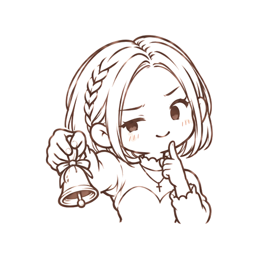
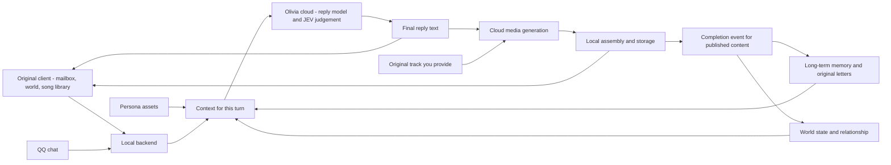

<p align="center"><b>English</b> | <a href="README.md">中文</a></p>
<div align="center">

  

# BSide Olivia Community

**Keep writing letters, getting replies and sharing a day-to-day life with Linli (林离), on your own PC.**

[](https://github.com/Ornn8/bside-olivia-community/actions/workflows/public-smoke.yml)
[](https://github.com/Ornn8/bside-olivia-community/releases/latest)
[](client/docs/WINDOWS_FULL_PATCH.md)
[](LICENSE)

**[Download the latest release](https://github.com/Ornn8/bside-olivia-community/releases/latest)** · [Quick start](#quick-start) · [English interface](#english-interface) · [Website](https://bside-moon.cn/en/) · [Report a problem](https://github.com/Ornn8/bside-olivia-community/issues)

</div>

<br>

BSide Olivia Community is an **unofficial** community companion project for Windows. It adds a local backend inside an isolated copy of the original client that you obtained legally ("Olivia", Steam version `0.0.9.627`). Writing a letter, waiting, and receiving a reply feels the way it always did, and the project adds long-term memory, Linli's daily world, QQ chat, voice, photos, and songs.

> [!NOTE]
> **Letters and memory stay on your PC; generation happens in the cloud.** Your letters, long-term memory, world records and received media are stored on your computer. Replies, semantic judgement, and voice, photos, songs and video are generated by the Olivia cloud service. You only need one Olivia account Key, and no GPU.

> [!NOTE]
> **English interface.** Since release 2.4.6 you can switch Olivia to English: open **Settings → Language → English**. See [English interface](#english-interface) below.

## What it does

<table>
<tr>
<td width="50%" valign="top">


### Letters and replies

Write a letter and, after a while, receive Linli's reply. A reply can be plain text, or it can come with her voice, a photo, or a song she sings for you, depending on what your letter says and which reply forms you allow. Audio plays right in the mailbox, with a waveform and a seek bar.

</td>
<td width="50%" valign="top">


### Covers and the song library

Give her an original track, confirm the lyrics, and send it off: Linli sings a cover in her own voice. You can also ask her to write an original song. Finished songs appear in your mailbox and can be saved to the song library.

</td>
</tr>
<tr>
<td valign="top">



### QQ chat

Link your QQ account and chat with Linli there. In everyday chat she often answers with a short voice message of a sentence or two, and when you ask for a photo or a voice message she sends one. She may also reach out at a good moment, and she respects a request like "please don't bother me for a couple of days".

</td>
<td valign="top">


### Linli's world

The World page shows her plans for today, what she is doing, and how she feels right now. Her life moves along in real time: classes, meals, piano practice, sleep. Every day looks different.

</td>
</tr>
<tr>
<td valign="top">


### Long-term memory

She remembers what you have talked about, what you call each other, and what you agreed on, and a correction from you updates what she remembers. You can view, search, and correct memories in Settings.

</td>
<td valign="top">


### Your data stays with you

Letters can be exported as a backup in one click, and imported from the original game folder or from a backup file. Neither this repository nor the installer contains anyone's private letters.

</td>
</tr>
</table>

## English interface

From release **2.4.6**, the interface and its messages can be shown in English.

- Open **Settings → Language** and choose **English**. You can switch back to Chinese at any time.
- When English is selected, Linli also writes her letters, chat replies, diary and other text to you in English. Switch back to Chinese and she writes in Chinese again.
- The default is still Chinese, and updating does not change how you use Olivia today.
- A few items, for example the daily plans on the World page, are still shown in Chinese for now.

The documentation in `client/docs/` and the release notes are mostly in Chinese; this README and the [English website](https://bside-moon.cn/en/) are the English entry points.

## Quick start

You need **Windows 10/11 x64**, a legally obtained copy of the original client, version **`0.0.9.627`**, and an **Olivia account Key**.

1. **Download the installer.** On the [latest release](https://github.com/Ornn8/bside-olivia-community/releases/latest) page, download `Olivia-<version>-Setup-x64.exe`.
2. **Install.** Run it and choose the folder of the original game that you own on Steam. The installer creates an isolated copy and does not modify the original folder.
3. **Connect your account.** Open Olivia, click **Account** at the top right, get a Key or import one you already have, choose **Connect and save**, and start writing.

| Your situation | Which file to download |
| --- | --- |
| First installation | `Olivia-<version>-Setup-x64.exe` |
| Already installed, want to upgrade | `Olivia-<version>.zip` (or `.oliviapatch`). Pick it in **Settings → Updates and help → Choose a patch and update**, then quit Olivia completely and open it again. Version 2.4.0 and later can also update themselves. |
| Checking that a download is intact | The `.sha256` file is a checksum, not an installer component |

Optional models, such as the one for long-term memory, are installed on demand during the first-run setup after you connect your account. Upgrading keeps your letters, memory, Key and settings. For detailed steps, rollback and troubleshooting, see [Windows install, upgrade and rollback](client/docs/WINDOWS_FULL_PATCH.md) (Chinese).

The site's [download page](https://bside-moon.cn/download.html) is currently available in Chinese only; the installer is also attached to every release on GitHub.

### The Olivia account Key

One Key is used for replies, semantic judgement, memory upkeep, and the generation of voice, photos, songs and video. It is encrypted for the current Windows user with DPAPI, used only by the local backend, and never written to logs or pages.

Since 2.0.0 only the Olivia account Key is supported. Custom model endpoints and GPU server addresses are no longer supported.

## Releases

Every release, with attachments, upgrade notes and known issues, is on the [Releases page](https://github.com/Ornn8/bside-olivia-community/releases). The release notes live in [`client/docs/releases/`](client/docs/releases/) and are written in Chinese.

## What stays on your PC, and what is cloud

| Stored on your computer | Generated by the Olivia cloud |
| --- | --- |
| Letters and replies | Written replies |
| The long-term memory database | Semantic judgement (JEV) |
| Linli's world and relationship records | Voice, photos, songs, and lip-synced video |
| Voice, photos, songs and video you have received | |
| The encrypted Olivia Key | |

When something is generated, the context needed for that turn (relevant letters, memories and world state) is sent to the cloud service.

<details>
<summary><b>Technical overview</b></summary>

<br>



| Part | Role |
| --- | --- |
| Local backend | Python 3.12, aiohttp, background tasks, persistence and recovery, final video assembly with FFmpeg |
| Reply model | Olivia cloud reply service (OpenAI-compatible protocol); reasoning and final text are handled separately |
| JEV judgement | Structured semantic decisions: reply intent, media choice, what information to use, world updates, mood and memory extraction |
| Persona | Persona assets with sources and layers; the parts relevant to the current topic are selected |
| Memory and world | Local Mem0, offline embeddings, a SQLite ledger for daily life and relationship; hidden relationship values are never passed into replies directly |
| Media (cloud) | Speech, cover and original songs, photos, lip-synced video |
| Quality and checks | Provenance and state boundaries, schemas, pytest, Windows CI, release scans |

- If media generation fails, the written reply that was already sent is kept, and a retry does not record the relationship change twice.
- Published voice, photos or songs are linked to the original letter as completion events and written to the world log, so later replies can recall them. Only what was actually delivered is recorded.

The design and data boundaries are described in [Linli's world](client/docs/LINLI_WORLD.md) and [Data boundaries of daily life](client/docs/PRIVATE_WORLD_LIFE.md) (both Chinese).

</details>

<details>
<summary><b>Build from source and contribute</b></summary>

<br>

Ordinary users should use the installer from the releases page. The client source is in `client/`, and the commands below are run from that directory:

```powershell
git clone https://github.com/Ornn8/bside-olivia-community.git
cd bside-olivia-community/client
.\INSTALL.cmd
.\START.cmd
```

The install and start scripts need compatible original-client resources, which this repository does not provide. After starting, click **Account** at the top right to get or import an Olivia account Key.

```powershell
py -3.12 -m venv .venv
.\.venv\Scripts\Activate.ps1
python -m pip install -r requirements-dev.txt
python -m pytest -q
python baseline_hardening_scan.py --mode all
git diff --check
```

| Path | Contents |
| --- | --- |
| `client/runtime/` and the Python entry points in `client/` | Backend, memory, world, models and media orchestration |
| `client/linli_character/` | Public persona assets and their sources |
| `client/installer/` | Install, start, configure, upgrade and uninstall |
| `client/contracts/` | Schemas and public interface contracts |
| `client/tests/` | Synthetic tests and regression cases; no private letters |
| `client/tools/`, `client/docs/` | Engineering tools, user documentation and historical acceptance records (mostly Chinese) |

More entry points are in the [documentation index](client/docs/README.md) and the [repository layout](client/docs/REPOSITORY_LAYOUT.md). Before contributing, please read the [contributing guide](CONTRIBUTING.md), the [security policy](SECURITY.md) and the [code of conduct](CODE_OF_CONDUCT.md).

</details>

## Feedback

If something goes wrong, open **Settings → Updates and help → Export diagnostic bundle**, then describe the problem in an [issue](https://github.com/Ornn8/bside-olivia-community/issues) and attach the bundle. The bundle has had private content removed. Please do not attach your Olivia Key or unprocessed private letters.

## Contributors

Thanks to [@QiLiangaiBashan](https://github.com/QiLiangaiBashan) for the standalone memory migration tool, its user guide and the migration regression tests ([#508](https://github.com/Ornn8/bside-olivia-community/pull/508)).

## Privacy, copyright and distribution

This is an **unofficial** project. It is **not affiliated with, authorized by, or endorsed by** the original developer, the publisher, or any rights holder.

The source repository does not contain the original program or its resources, private letters, Olivia Keys, user databases, voice references, generated media, or third-party model weights. The installer contains core dependencies that are verified against a manifest and hashes.

The project's own code and original documentation, unless marked otherwise, are licensed under the [Apache License 2.0](LICENSE). That license grants no rights to the original game, its characters, trademarks, official assets, third-party models, or user content. See the [asset and rights policy](client/ASSET_POLICY.md), the [public repository boundary](client/docs/PUBLIC_REPOSITORY.md) and the [third-party notices](client/THIRD_PARTY_NOTICES.md) (Chinese).
